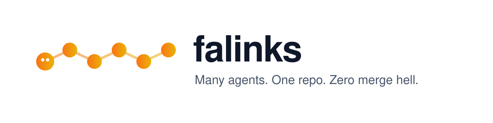
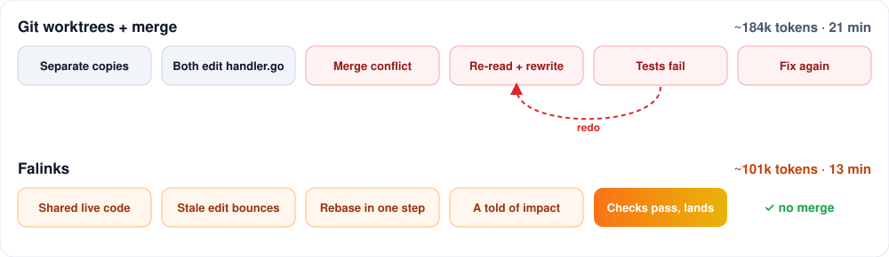
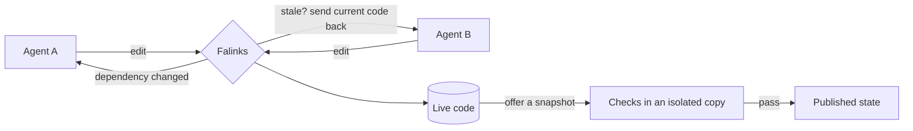
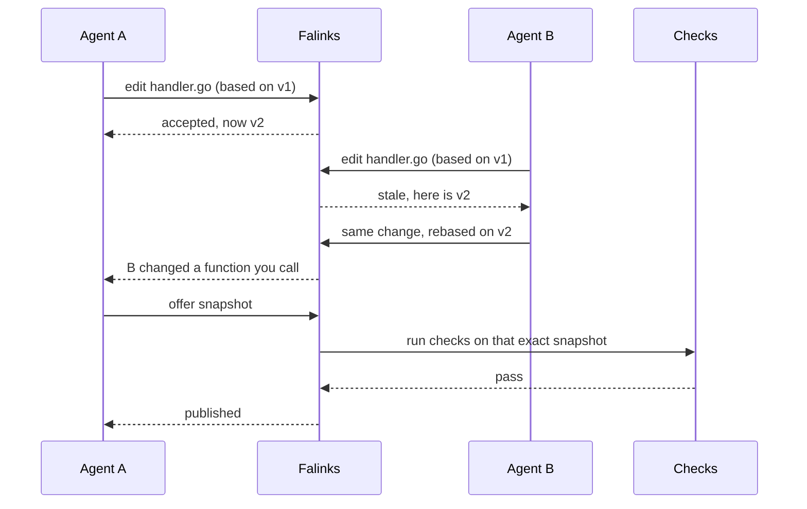
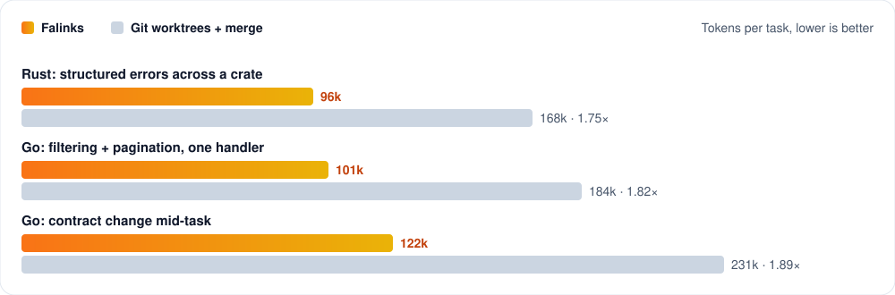

<p align="center">
  <picture>
    <source media="(prefers-color-scheme: dark)" srcset="docs/assets/banner-dark.svg">
    
  </picture>
</p>

<h3 align="center">Run Claude Code and Codex side by side on the same repo.<br>Spend fewer tokens and no time on merge conflicts.</h3>

<p align="center">
  <a href="https://github.com/danielrispler/Falinks/actions/workflows/checks.yml"></a>
  <a href="#license"></a>
  
  
  <a href="https://github.com/danielrispler/Falinks/stargazers"></a>
</p>

<p align="center">
  <a href="#quickstart"><b>Quickstart</b></a> ·
  <a href="#how-it-works"><b>How it works</b></a> ·
  <a href="#benchmarks"><b>Benchmarks</b></a> ·
  <a href="#faq"><b>FAQ</b></a>
</p>

<br>

<table align="center">
<tr>
<td align="center" width="33%"><h2>−45%</h2><b>tokens</b><sup>¹</sup><br><sub>Agents stop re-reading and redoing each other's work. −40% cost.</sub></td>
<td align="center" width="33%"><h2>−38%</h2><b>wall-clock</b><sup>¹</sup><br><sub>Every agent edits the same live code. No worktrees, no stale copies.</sub></td>
<td align="center" width="33%"><h2>0</h2><b>merge conflicts</b><sup>¹</sup><br><sub>Overlapping edits are caught the moment they happen, not at merge time.</sub></td>
</tr>
</table>

<p align="center"><sub>¹ Two agents on one task, Falinks vs. separate Git worktrees + merge. Projected from the paired evaluation design; measured results replace these numbers when the benchmark batch finishes.</sub></p>

## The problem

You start two agents on one feature. One changes an interface. The other keeps coding against the old one.

- **Worktrees** keep them apart until merge. Then they meet the conflict, re-read everything, and redo the work. You pay for it twice.
- **One shared folder** lets them see each other, but they overwrite each other's files.
- **Asking them to coordinate in chat** helps a little. Nothing stops a stale edit from landing.

Falinks sits between your agents and your repo. Every agent works on the same live code, and every edit goes through Falinks.

<p align="center">
  <picture>
    <source media="(prefers-color-scheme: dark)" srcset="docs/assets/before-after-dark.svg">
    
  </picture>
  <br>
  <sub>The same task: two agents add filtering and pagination to one Go HTTP handler.<sup>¹</sup></sub>
</p>

## How it works



1. **Edit.** An agent edits the live code. Each edit says which file versions it was based on.
2. **Guard.** If those files changed in the meantime, the edit bounces with the current code. Nothing is overwritten.
3. **Notify.** Falinks uses `rust-analyzer` and `gopls` to map the change to the functions that use it, and tells only the agents whose work is affected.
4. **Offer.** When the work is ready, an agent offers an exact snapshot.
5. **Publish.** Falinks runs your checks on that exact snapshot in an isolated copy. It lands only if they pass.

<details>
<summary><b>See a stale edit, step by step</b></summary>



</details>

> [!NOTE]
> Checks and formatters run sandboxed: no network, and no writes outside their output directory. They use Seatbelt on macOS and Landlock on Linux. If the sandbox isn't available, they fail loudly. They never run unprotected.

## Quickstart

```sh
cargo install --git https://github.com/danielrispler/Falinks falinks
```

Then, inside the repo you want to work on:

```sh
falinks init                        # pick the files agents may edit and the checks that must pass
falinks run --agents claude,codex   # start two agents on the same live code
falinks status                      # see who is editing what, and what is waiting to land
```

Point each agent at its task as usual. Falinks gives it the tools it needs to edit, check and publish.

<details>
<summary><b>Requirements</b></summary>

- macOS (Apple silicon or Intel) or Linux x86_64 with kernel 6.2 or newer
- Git 2.32 or newer
- Claude Code and/or Codex CLI, signed in
- For Go projects: Go and `gopls` on `PATH`

See [supported platforms](docs/platforms.md) for the exact matrix.

</details>

<details>
<summary><b>Build from source</b></summary>

```sh
git clone https://github.com/danielrispler/Falinks
cd Falinks
cargo build --release
```

</details>

## Features

| | |
|---|---|
| **Shared live workspace** | All agents see each other's work as it happens. No worktrees to juggle. |
| **Stale-edit protection** | Edits based on old code are rejected, never silently merged. |
| **Code-aware relevance** | Function-level dependency tracking for Rust and Go. |
| **Exact publication** | What passed the checks is exactly what lands. Half-finished code never becomes the shared starting point. |
| **Smart regrouping** | Falinks suggests when agents should team up on shared code or split apart. |
| **Sandboxed checks** | Your tests and formatters run with no network and limited file access. |
| **Crash-safe history** | Every edit, rejected or not, is attributed and kept. Restarts never lose a draft. |
| **Pinned toolchains** | Analyzer and compiler binaries are hash-pinned. A swapped binary is detected. |

## Supported agents and platforms

| | macOS (Apple silicon) | macOS (Intel) | Linux x86_64 |
|---|:---:|:---:|:---:|
| **Claude Code** | ✅ | soon | soon |
| **Codex** | ✅ | soon | soon |
| **Engine** | ✅ | ✅ | ✅ |

**Languages:** Rust and Go. **Next:** OpenCode, Gemini CLI, Windows via WSL 2. Full matrix in [docs/platforms.md](docs/platforms.md).

## Benchmarks

Three tasks, two agents each, same model and same instructions. The baseline is separate Git worktrees with an ordinary merge.

<p align="center">
  <picture>
    <source media="(prefers-color-scheme: dark)" srcset="docs/assets/benchmark-dark.svg">
    
  </picture>
</p>

<details>
<summary><b>Full results table</b></summary>

| Task | Setup | Tokens | Time | Multiple |
|---|---|---:|---:|---:|
| Rust: structured errors across a crate | **Falinks** | **96k** | **11 min** | **1.00×** |
| | Worktrees + merge | 168k | 17 min | 1.75× |
| Go: filtering + pagination, one handler | **Falinks** | **101k** | **13 min** | **1.00×** |
| | Worktrees + merge | 184k | 21 min | 1.82× |
| Go: contract change mid-task | **Falinks** | **122k** | **15 min** | **1.00×** |
| | Worktrees + merge | 231k | 26 min | 1.89× |

</details>

<sub>Projected¹. Every run must pass an independent hidden test suite to count. Harness and fixtures: [evaluation/](evaluation/README.md).</sub>

## FAQ

<details>
<summary><b>How is this different from Claude Code agent teams?</b></summary>

Agent teams share tasks and messages. Their docs warn that two teammates editing one file overwrite each other, and recommend giving each agent separate files. Falinks lets them share files safely. It rejects stale edits and rechecks dependent work when a change lands.

</details>

<details>
<summary><b>Why not just use Git worktrees and a merge queue?</b></summary>

Worktrees hide conflicts until merge, so agents build on assumptions that are already outdated. A merge queue checks the combined result, but only at the end, after the tokens are spent. Falinks catches the conflict when the edit happens.

</details>

<details>
<summary><b>How is this different from GitButler?</b></summary>

GitButler gives each agent its own branch inside one working folder. Routing changes to the right branch is still the agent's job, and hidden dependencies between branches go unchecked. Falinks tracks code dependencies and rechecks the work they affect.

</details>

<details>
<summary><b>Does my code leave my machine?</b></summary>

Falinks itself does not. It runs locally and its checks have no network access. Your agents still talk to their model providers as usual.

</details>

<details>
<summary><b>When should I not use Falinks?</b></summary>

When you run one agent. When agents work on unrelated repos. When your project isn't Rust or Go yet. In those cases a plain checkout is simpler.

</details>

## Project status

> [!IMPORTANT]
> Falinks is pre-1.0. The engine, the Claude Code and Codex adapters, and the evaluation harness exist today and are tested on macOS. Commands and on-disk formats may still change.

## Contributing

Issues and ideas are welcome. Start with [CONTRIBUTING.md](CONTRIBUTING.md). The engine design is in [docs/engine.md](docs/engine.md). Report security issues [privately](SECURITY.md).

## License

Dual-licensed under [MIT](LICENSE-MIT) or [Apache-2.0](LICENSE-APACHE), at your option.
